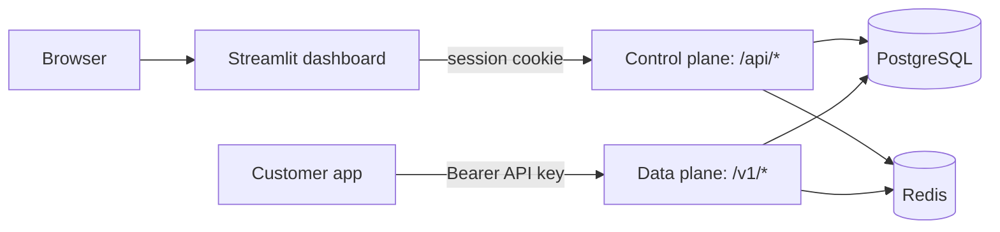
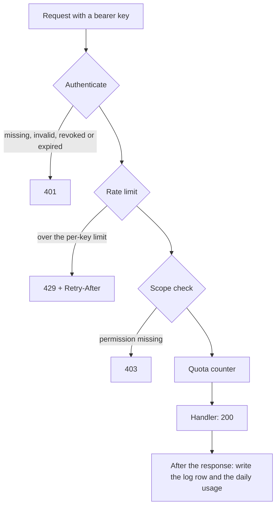

# API Console

An API key manager with a usage dashboard, built the way AI providers like OpenAI run their developer consoles. Users sign up, create API keys, call a (dummy) AI API with those keys, and watch their own usage: requests, tokens, errors and latency.

The service behind the keys returns fake data. Everything around it is real: key authentication, per-key rate limits, scoped permissions, usage tracking, plans, and a dashboard where each user sees only their own activity.

<!--
Add your screenshots to a docs/ folder, then uncomment these lines:


-->

## Features

**API platform**
- Create, list and revoke API keys. The full key is shown once, and only a SHA-256 hash is stored.
- Every request is authenticated with `Authorization: Bearer <key>`. Revoked keys stop working on the next request (measured in about 15 ms locally; the requirement was 1 second).
- Per-key rate limits that follow the account's plan: Free 100 requests/min, Pro 1000 requests/min. Limits are per key, not per IP.
- Scoped keys: each key gets named permissions (`models`, `chat`) and gets `403` on anything else.
- Key expiry with its own `key_expired` error, and an optional monthly quota with a webhook alert at 80%.
- A request log (key, endpoint, status, latency, tokens) kept for 30 days, plus a daily usage rollup that keeps all-time totals.

**Accounts and dashboard**
- Sign up and log in (passwords hashed with salted `scrypt`, sessions stored in Redis in `httpOnly` cookies).
- Every key belongs to a user. Every dashboard query is filtered by the logged-in user, so users can never see each other's keys or usage.
- Free and Pro plans with limits on active keys (3 and 10). Upgrading or downgrading updates every key right away. Payments are simulated.
- A Streamlit console with four pages:
  - **Usage:** requests, tokens, error rate and average latency for any period, daily charts, usage per key, and recent requests.
  - **API keys:** create keys (permissions and expiry), see them listed, revoke them.
  - **Quickstart:** copy-paste examples in PowerShell, curl, Python and JavaScript, plus a "Try it" panel that calls the API with only a key, like a customer's app would.
  - **Plan:** compare plans and switch between them.

**The dummy AI service**
- `GET /v1/models` lists three fake models.
- `POST /v1/chat/completions` returns a canned reply with estimated token counts and a simulated response time that depends on the model.

## Architecture

There are two ways in, with different credentials: people use the dashboard with a login session (the control plane), and customers' programs call the API with a key (the data plane).



Every request to the public API passes the same four gates:



**Where data lives**
- PostgreSQL (kept): `users`, `api_keys`, `request_logs` (30 days of detail), `usage_daily` (daily totals, kept forever).
- Redis (fast, short-lived): `key:<hash>` cached key records, `rl:<key>:<minute>` rate counters, `quota:<key>:<month>` quota counters, `sess:<hash>` login sessions.

## Tech stack

- **API:** Node.js, Express, `pg`, `ioredis`
- **Storage:** PostgreSQL 16, Redis 7, run with Docker Compose
- **Dashboard:** Python, Streamlit, `requests`, `pandas`
- **Tests:** a Node end-to-end script and a headless Streamlit test suite

## Getting started

You need Node.js 20 or newer, Docker Desktop, and Python 3.10 or newer.

```powershell
npm install
copy .env.example .env
docker compose up -d
Get-Content schema.sql | docker exec -i akm-postgres psql -U akm -d akm
node src/server.js
```

On macOS or Linux, use `cp .env.example .env` and `docker exec -i akm-postgres psql -U akm -d akm < schema.sql`.

Edit `.env` and set a long random `ADMIN_TOKEN`. Then start the dashboard in a second terminal:

```powershell
python -m pip install -r dashboard/requirements.txt
python -m streamlit run dashboard/app.py
```

Open http://localhost:8501, sign up, create a key, and call the API with it. To fill the charts with demo data:

```powershell
node scripts/traffic.js
```

### Configuration

| Variable | Used by | Meaning |
|---|---|---|
| `PORT` | API | Port for the API (default 3000) |
| `DATABASE_URL` | API | PostgreSQL connection string |
| `REDIS_URL` | API | Redis connection string |
| `ADMIN_TOKEN` | API | Secret for the internal `/admin/*` endpoints |
| `API_BASE_URL` | Dashboard | Where the API runs (default `http://localhost:3000`) |

## Calling the API

```bash
curl http://localhost:3000/v1/chat/completions \
  -H "Authorization: Bearer YOUR_API_KEY" \
  -H "Content-Type: application/json" \
  -d '{"model": "dummy-small", "messages": [{"role": "user", "content": "Hello!"}]}'
```

### Public API (API key)

| Method | Path | Permission | Returns |
|---|---|---|---|
| GET | `/v1/models` | `models` | The list of models |
| POST | `/v1/chat/completions` | `chat` | A dummy reply and token usage |

Authenticated responses include `X-RateLimit-Limit`, `X-RateLimit-Remaining` and `X-RateLimit-Reset`.

| Status | Code | Meaning |
|---|---|---|
| 400 | `invalid_model`, `invalid_messages` | The request body is wrong |
| 401 | `missing_key`, `invalid_key`, `key_revoked`, `key_expired` | The key can't be used |
| 403 | `scope_forbidden` | The key lacks permission for this endpoint |
| 429 | `rate_limit_exceeded` | Too many requests (see `Retry-After`) |

### Dashboard API (login session)

| Method | Path | Purpose |
|---|---|---|
| POST | `/api/signup`, `/api/login`, `/api/logout` | Accounts and sessions |
| GET | `/api/me` | The logged-in user and plan |
| GET | `/api/plans` | Plan definitions (public) |
| POST | `/api/plan` | Switch plan |
| GET, POST | `/api/keys` | List or create your keys |
| DELETE | `/api/keys/:id` | Revoke one of your keys |
| GET | `/api/usage?from=&to=&key_id=` | Totals, daily breakdown and per-key usage |
| GET | `/api/logs?key_id=&limit=` | Recent requests (last 30 days) |

Another user's key id always answers `404`.

### Admin API (internal)

Protected by `ADMIN_TOKEN`, used by the end-to-end tests and for keys with quotas and webhooks: `POST` and `GET /admin/keys`, `DELETE /admin/keys/:id`, `GET /admin/keys/:id/logs` and `/usage`. Two demo routes, `/read/hello` and `/write/hello`, exist for the tests.

## Testing

```powershell
npm run test:e2e
python dashboard/test_app.py
```

- `scripts/e2e.js` runs 34 checks against the running API: authentication, scopes, per-key rate limits, revocation speed, expiry, input validation, the quota webhook, usage totals and logs. Expected last line: `34 passed, 0 failed`.
- `dashboard/test_app.py` runs 53 checks on the dashboard with a fake API, so nothing else needs to be running: login, usage, keys, quickstart, plans, friendly error messages, and the API client over real HTTP. Expected last line: `53 passed, 0 failed`.
- `scripts/burst.js` sends 20 simultaneous requests to show that rate limiting holds under concurrency.

## Design decisions

- **Hashed keys, shown once.** A leaked database does not leak usable keys.
- **Cached key lookups with explicit invalidation.** Redis caches each key record, and revoking, changing a plan or changing a key deletes the cached copy right away. Expiry needs no invalidation because the deadline is checked on every request.
- **Atomic counters.** Rate limits and quota alerts use Redis `INCR`, so counts stay correct under concurrent requests, and a quota alert fires exactly once.
- **Identity comes only from the session.** Every dashboard query filters by the logged-in user, never by an id taken from the URL or the request.
- **Named permissions, not raw scopes.** Users choose `models` or `chat`, so they can't grant themselves access to anything else.
- **Logs and daily totals are written in one SQL statement,** so they can't drift apart because of a failure. Dashboard numbers come from the daily table, so all-time totals survive log cleanup.
- **The logger is service-agnostic.** The service reports tokens through `res.locals.tokens`, so the manager works for any service.
- **The dashboard is only a client of the API.** It has no database access, so it could be replaced with another front end.

## Known limitations

- Rate limiting uses fixed one-minute windows, so up to twice the limit can pass around a boundary.
- Logs are written best-effort: if the database is down, those rows are lost. There is no job yet that deletes logs older than 30 days (the API only returns the last 30).
- Token counts are estimates (characters divided by 4), not real tokenizer counts.
- Webhooks are available only through the admin API, with no retries and no signing, and the destination is not checked, which would allow server-side request forgery if users could set it.
- Plan changes are simulated (no payments). Keys keep the permissions they were created with.
- Refreshing the dashboard tab logs you out, because its state lives in the Streamlit server.
- Tested on one laptop with a handful of users, so it shows correctness, not performance at scale.
